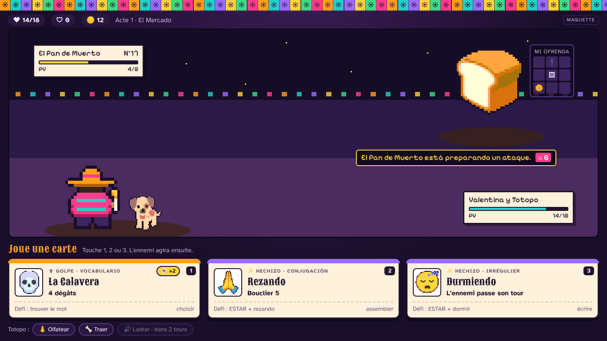
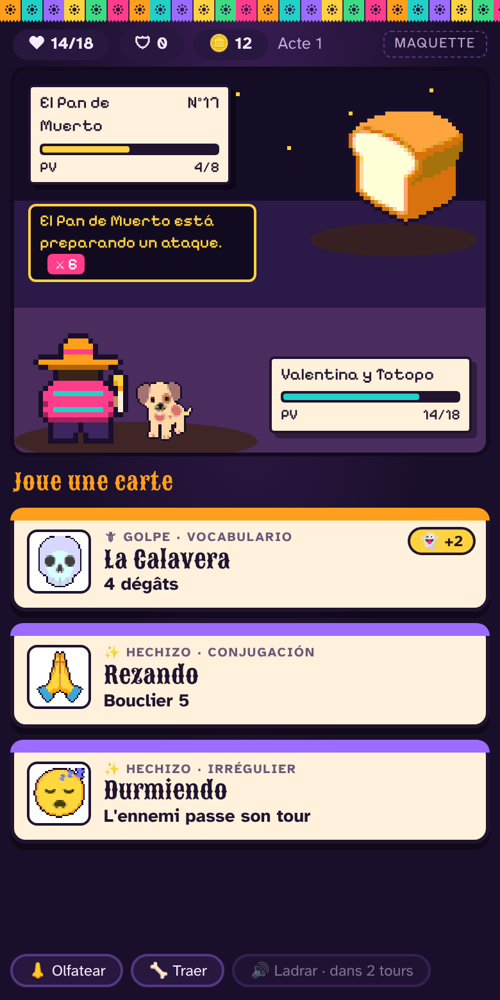
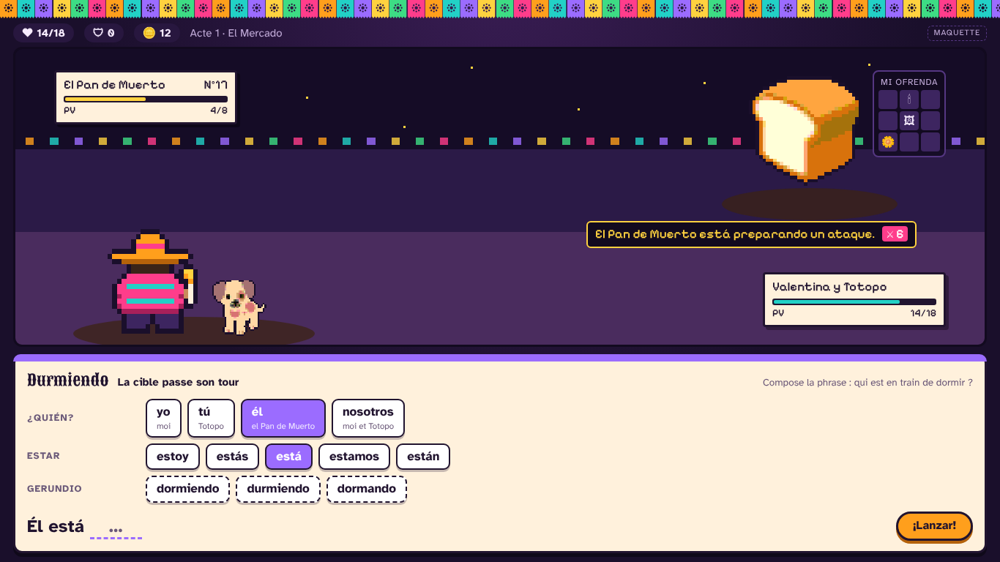
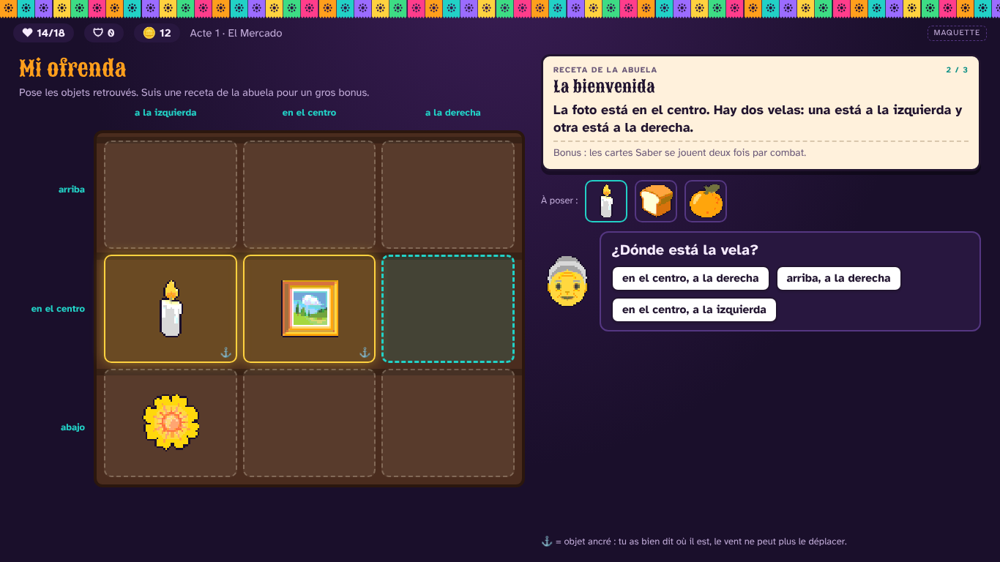

# El Camino de Cempasúchil, version 2 : document de conception

*Étape 1. Proposition validée le 13/11/2026. S'appuie sur [`AUDIT.md`](AUDIT.md).*

## En une page

**Le constat.** Dans la version 1, répondre juste est la seule chose à faire, et toute bonne réponse produit le même effet. C'est pour cela que c'est un quiz habillé.

**L'idée centrale.** Dans la version 2, **ce que l'élève dit en espagnol, c'est ce qui se passe à l'écran.**

- Il écrit *El alebrije está durmiendo* : l'alebrije s'endort et passe son tour. Il écrit *Estamos comiendo* : lui et son chien reprennent des forces.
- Il lit *La vela está arriba, a la izquierda* : il pose la bougie au bon endroit de sa ofrenda, et elle se met à briller.
- Il entend *¡La calavera!* : s'il joue la carte de la calavera, le coup est critique.

**La forme.** Un jeu de cartes de lotería. À chaque tour, l'élève voit ce que l'ennemi prépare, reçoit trois cartes, **en joue une**. Chaque carte demande un geste de langue différent et produit un effet différent. Choisir la bonne carte au bon moment, c'est le jeu. Réussir le geste, c'est l'espagnol. Les deux sont indissociables.

**Ce qui est gardé.** Les 454 questions validées, la correction tolérante, la scène de combat façon console portable, l'espace professeur, la pile technique, le fonctionnement hors ligne, l'absence totale de données personnelles.

**Ce qui change.** Le combat, les objets (qui deviennent une ofrenda que l'on construit), la répétition des erreurs, la mise en page, le son, et tout ce qui se passe entre deux parties.

**Ce que je te demande.** Lire les sections 2 et 3 (le cœur), regarder les maquettes, puis trancher les sept décisions de la [section 17](#17-décisions-à-valider). Le reste est du détail qui se règle en route.

**Maquettes** (images fabriquées pour ce document, pas le jeu) :

| Combat sur PC | Combat sur téléphone |
|---|---|
|  |  |

| Lancer un sort | Construire la ofrenda |
|---|---|
|  |  |

Les trois maquettes PC sont à la taille d'un écran de collège (1366 × 768) : tout y tient sans défiler. Totopo y est figuré par un chiot provisoire ; son vrai dessin, pixel par pixel, te sera soumis.

---

## 1. Cinq règles de conception

Elles servent à trancher tous les choix qui suivent.

1. **Le sens produit l'effet.** Une action de jeu n'est pas la récompense d'une bonne réponse : elle *est* la phrase espagnole. Si on peut remplacer l'espagnol par des maths sans rien changer au jeu, la mécanique est à refaire.
2. **Un choix à chaque tour.** Toujours au moins deux options raisonnables, et une information (l'intention de l'ennemi) pour décider.
3. **Une seule nouveauté à la fois.** Un élève de 12 ans doit comprendre sans notice. Chaque combat du premier acte introduit une chose, pas deux.
4. **L'erreur coûte un tour, pas la partie.** Une carte ratée ne fait rien, la correction s'affiche, et la question revient plus tard comme une occasion à saisir. L'élève fragile doit finir sa partie en ayant appris.
5. **Tout tient à l'écran.** L'ennemi, sa réaction et la zone de réponse sont visibles ensemble, sans défiler, sur un PC de collège comme sur un téléphone.

---

## 2. La boucle de jeu

Trois boucles emboîtées.

### 2.1 Le tour (15 à 20 secondes)

```
1. L'ennemi annonce       « El Pan de Muerto está preparando un ataque. »  ⚔ 6
2. Tu reçois 3 cartes     🗡 La Calavera     ✨ Rezando     ✨ Durmiendo
3. Tu en joues UNE        (touche 1, 2 ou 3)
4. Tu fais le geste       la carte s'ouvre : c'est le défi en espagnol
5. L'effet se joue        sur la scène, sous tes yeux
6. L'ennemi agit          s'il le peut encore
```

Exemple. L'ennemi a 4 PV et prépare une attaque de 6. En main :

- **La Calavera** (4 dégâts) : je l'achève, à condition de connaître le mot. Si je me trompe, je prends 6.
- **Rezando** (bouclier 5) : sans risque, mais le combat dure.
- **Durmiendo** (l'ennemi passe son tour) : très fort, mais le gérondif est irrégulier. Est-ce que je suis sûr de *durmiendo* ?

La décision dépend de ce que l'élève **sait qu'il sait**. C'est exactement ce qu'on cherche à développer en révision.

Trois différences avec la version 1 :

- **L'ennemi agit à chaque tour**, pas seulement quand l'élève se trompe. Même un élève à 100 % de réussite doit donc se défendre, endormir, viser : il y a un jeu pour lui.
- **Une carte ratée ne fait rien**, sans pénalité supplémentaire. La punition, c'est l'intention de l'ennemi qui s'exécute.
- **Plus de bouton « Continuer » après une bonne réponse.** L'effet se joue et la main suivante arrive. Après une erreur, la correction reste affichée jusqu'à ce que l'élève clique « Compris ».

### 2.2 La partie (15 à 25 minutes)

```
Prologue (30 s) → ACTE 1 El Mercado → ACTE 2 El Panteón → ACTE 3 El Mictlán → Fin
                   chaque acte : carte à embranchements, 5 étages
                   2 ou 3 combats · 1 rencontre ou tianguis · 1 ofrenda · 1 jefe
```

En avançant, l'élève construit deux choses :

- **sa baraja**, son paquet de cartes : il en gagne une après chaque combat (au choix parmi trois), peut en améliorer ou en retirer ;
- **sa ofrenda** : une grille de 3 × 3 où il pose les objets retrouvés. Elle remplace la liste de reliques de la version 1.

Budget visé : environ 48 tours de combat par partie (contre 35 à 60 questions aujourd'hui), plus les rencontres et la ofrenda. La durée sera réglée par simulation, puis vérifiée avec une vraie classe.

Une **partie courte** d'un seul acte (8 à 10 minutes) existe pour les fins de séance et le défi du jour.

### 2.3 Entre les parties

- **Mi jardín** : une fleur de cempasúchil par notion, qui pousse avec la maîtrise (section 8).
- **Las almas pendientes** : les questions ratées attendent l'élève au début de la partie suivante (section 8).
- **El álbum de lotería** : cartes, ennemis calmés et objets rencontrés.
- **Déblocages** étalés : personnages, cartes, Niveaux de Calavera (section 6).
- **El reto del día** : la même partie courte pour toute la classe (section 9).

---

## 3. L'espagnol comme mécanique

Sept gestes de langue. Pour chacun : le fonctionnement, l'intérêt pour le jeu, l'intérêt pour l'apprentissage, et d'où vient le contenu.

### 3.1 Conjurar : les sorts se lancent en conjuguant

**Fonctionnement.** Une carte de sort porte un verbe. Pour la lancer, l'élève compose **sujet + ESTAR + gérondif**. Le verbe décide de l'effet, **le sujet décide de la cible** :

| Sujet | Cible |
|---|---|
| *yo* estoy… | moi |
| *tú* estás… | mon compagnon (je lui parle) |
| *él / ella* está… | l'ennemi (*él* pour el Pan, *ella* pour la Vela) |
| *nosotros* estamos… | moi et mon compagnon |
| *ellos / ellas* están… | tous les ennemis |

*Vosotros* apparaît quand la abuela s'adresse à l'élève et à son chien (« ¡Estáis bailando muy bien! »), en mode classe, et dans les questions de la banque.

Les verbes viennent de ta fiche ESTAR + GERUNDIO et de tes textes. Leur effet correspond à leur sens :

| Carte | Gérondif | Effet | Source |
|---|---|---|---|
| Comiendo | comiendo | la cible récupère 4 PV | fiche |
| Rezando | rezando | bouclier de 5 | P2 |
| Cantando | cantando | courage : la prochaine carte est renforcée | fiche |
| Bailando | bailando | esquive la prochaine attaque | texte |
| Tocando | tocando | la musique frappe tous les ennemis | texte |
| Decorando | decorando | renforce un objet de la ofrenda pour ce combat | P2 |
| Volando | volando | hors de portée pendant un tour | description d'image |
| **Durmiendo** | d**u**rmiendo | la cible s'endort et passe son tour | fiche, irrégulier |
| **Leyendo** | le**y**endo | lit les trois prochaines intentions, pioche une carte | fiche, irrégulier |
| **Oyendo** | o**y**endo | entend le point faible : prochain coup critique | fiche, irrégulier |
| **Trayendo** | tra**y**endo | le compagnon rapporte une carte déjà jouée | fiche, irrégulier |
| **Pidiendo** | p**i**diendo | demande de l'aide : une âme amie frappe | fiche, irrégulier |
| **Diciendo** | d**i**ciendo | dit la vérité : brise le bouclier, démasque un déguisé | fiche, irrégulier |

Les gérondifs irréguliers sont les sorts les plus puissants. Le risque et la récompense vont ensemble.

Le même sort se lance de quatre façons, selon la maîtrise de l'élève (section 8) :

1. choisir la bonne forme d'ESTAR parmi trois, le gérondif est donné ;
2. choisir ESTAR et le gérondif parmi des tuiles, pièges compris (*dormiendo*, *leiendo*) ;
3. écrire le gérondif ;
4. écrire toute la phrase (« a la pluma ») : effet renforcé.

Un accent oublié (*esta* pour *está*) donne un « ¡Casi! » : le sort part à moitié.

- **Pour le jeu.** Endormir, protéger, soigner, prévoir : ce sont les outils de tout jeu de stratégie. Choisir la cible ouvre des coups malins (*estamos comiendo* soigne deux personnages pour une carte).
- **Pour l'apprentissage.** La personne du verbe n'est plus une case à remplir : elle désigne quelqu'un à l'écran. L'élève voit l'action « en train de se faire », ce qui est exactement la valeur d'ESTAR + gérondif selon ta fiche (« acciones en desarrollo »).

**Et l'état de tout le combat s'écrit dans la même structure.** Sous chaque personnage, une légende : *El alebrije está durmiendo*, *La calaverita está rezando* (bouclier), *El esqueleto está tocando* (son attaque monte), *Estás bailando*. L'élève lit du ESTAR + gérondif à chaque tour pour savoir quoi faire, sans que ce soit un exercice.

### 3.2 Situar : viser et construire avec *arriba, a la izquierda, en el fondo*

Deux usages, avec les outils de ta fiche de description d'image.

**Viser.** Certains ennemis se cachent ou s'éloignent : el Papel Picado s'envole, el Alma Errante se dédouble. La scène montre trois silhouettes et une phrase : *El alma está en el fondo, a la derecha.* L'élève touche le bon endroit pour frapper. Quand la notion est maîtrisée, c'est l'inverse : il voit où est l'ennemi et doit le **dire** pour que le coup parte.

**Construire la ofrenda.** Les objets retrouvés (vela, flor, pan, foto, frutas…) se posent sur une grille *arriba / en el centro / abajo* × *a la izquierda / en el centro / a la derecha*. Chaque objet donne un bonus. Les **recetas de la abuela** donnent beaucoup plus, à condition de les suivre :

> **La bienvenida.** La foto está en el centro. Hay dos velas: una está a la izquierda y otra está a la derecha.

Aucune traduction. Si l'élève place juste, la recette s'allume. Et quand il pose un objet librement, le jeu lui demande *¿Dónde está la vela?* : s'il le dit correctement, l'objet est **ancré** et le vent ne pourra plus le déplacer.

Car des ennemis s'en prennent à la ofrenda : el Viento Frío déplace un objet (« Ahora la vela está abajo, a la derecha »), el Gato Travieso en fait tomber un, la Calaverita en emporte un le temps d'un combat.

- **Pour le jeu.** La ofrenda est le « moteur » que l'élève assemble pendant la partie, visible, joli, à lui. Elle remplace une liste de dix-neuf pastilles par un objet qu'on a envie de compléter.
- **Pour l'apprentissage.** Lire une description pour agir (compréhension), puis décrire pour sécuriser (production). C'est l'activité « décrire une image » de la séquence, faite vingt fois par plaisir. HAY et ESTAR sont employés dans leur vrai rôle : *hay* pour dire ce qu'il y a, *está* pour dire où.

### 3.3 Definir y contar : SER, ESTAR, HAY

- ***Es…*** (définir) démasque. Tes documents parlent de gens déguisés en squelettes, calaveras, morts-vivants : un groupe d'enfants déguisés arrive, et pour toucher le bon il faut lire *Es un esqueleto. Está a la izquierda.*
- ***Hay…*** (compter) frappe selon ce qu'il y a sur la ofrenda : *Hay tres velas* fait trois fois plus mal qu'*Hay una vela*. L'élève choisit ou écrit la phrase vraie.
- Les deux se combinent avec *Está…* pour situer.

- **Pour le jeu.** Trois outils distincts : révéler, compter, viser.
- **Pour l'apprentissage.** La règle de ta fiche (« SER : para definir. ESTAR : para situar. Hay = il y a ») devient trois gestes différents avec trois effets différents. Se tromper de verbe, c'est faire le mauvais geste, et ça se voit.

### 3.4 Escuchar : la lotería del Gritón

À la lotería, un meneur de jeu annonce les cartes à voix haute. Le jeu reprend ce principe.

- **En combat**, contre les ennemis de la nuit (la Lechuza) ou avec la carte *Oyendo* : la voix dit un mot ou une courte phrase. Si l'élève joue la carte ou touche l'image correspondante, le coup est critique.
- **En rencontre**, une vraie petite partie de lotería : une planche de neuf images, la voix annonce, l'élève marque. Une ligne complète : *¡Lotería!*

La voix est celle du navigateur, **uniquement si elle est installée sur l'appareil** (correction du bug n° 4 de l'audit). Sans voix, son coupé, ou si tu désactives l'écoute dans l'espace professeur : le mot s'affiche une seconde puis disparaît (« lecture éclair »), comme aujourd'hui.

- **Pour le jeu.** Un moment de tension différent, sans texte à l'écran.
- **Pour l'apprentissage.** Reconnaître à l'oral le vocabulaire de la séquence. Limite assumée : la qualité de la voix dépend de l'appareil, c'est un entraînement à l'oreille, pas un modèle de prononciation.

### 3.5 Ordenar : les candados de papel picado

Sur la carte, certains passages sont fermés par une guirlande de papel picado dont les mots sont mélangés. Remettre la phrase en ordre ouvre un raccourci vers un coffre ou une rencontre rare. Échouer ne coûte rien : on prend le chemin normal.

Entre deux actes, le résumé de ce qui vient de se passer est une phrase à reconstruire : *El alebrije / está / durmiendo / en / el mercado*.

- **Pour le jeu.** Un risque choisi, pas imposé. La carte gagne des secrets.
- **Pour l'apprentissage.** L'ordre des mots et la structure ESTAR + gérondif. C'est la forme la plus proche d'un geste dans la version 1 ; elle passe de 8 % des questions à un rôle à part.

### 3.6 Elegir : des dialogues où comprendre change l'issue

Les rencontres deviennent de vrais échanges. Les répliques sont en espagnol, **sans traduction affichée**, et il n'y a pas de bonne ou de mauvaise réponse : l'élève obtient ce qu'il a dit.

> **La panadera.** —Estoy preparando pan de muerto. ¿Me ayudas?
>
> 1. *Sí, estoy decorando el pan.* → elle t'offre un pan pour ta ofrenda.
> 2. *No, estoy visitando el cementerio.* → elle t'indique le chemin : la carte de l'acte se dévoile.
> 3. *Estoy comiendo el pan.* → tu récupères des PV, mais elle n'est pas contente : le tianguis sera plus cher.

Pour ne pas bloquer : le compagnon peut **flairer** un mot (toucher un mot affiche sa traduction), un nombre limité de fois par partie. Ce nombre augmente pour les élèves dont la maîtrise est basse.

- **Pour le jeu.** Des choix avec des conséquences, de l'humour, des personnages.
- **Pour l'apprentissage.** Lire pour décider. L'élève qui clique au hasard obtient quelque chose au hasard ; celui qui comprend obtient ce qu'il veut.

### 3.7 Nombrar y saber : les 454 questions deviennent des cartes

Les cartes d'attaque (**Golpes**) portent un mot du vocabulaire et tirent leur défi dans les questions de vocabulaire. Les cartes de **Saber** portent une idée de tes textes (*La tradición*, *Mayas y aztecas*, *La Catrina de Posada*) et tirent leur défi dans les questions de culture.

Rien n'est jeté : toute la banque validée alimente ces deux familles, avec la même correction et le même garde-fou contre les questions voisines.

- **Pour le jeu.** Des cartes simples et fiables pour équilibrer les sorts risqués.
- **Pour l'apprentissage.** Le vocabulaire est manipulé comme objet à chaque tour (*La Vela*, *El Pan*, *La Calavera* sont les noms des cartes) en plus d'être interrogé.

---

## 4. Profondeur : cartes, états, styles de jeu

### 4.1 Quatre familles de cartes

Une famille par thème de la banque. Elle se reconnaît à sa couleur **et** à son icône.

| Famille | Thème | Rôle | Geste de langue |
|---|---|---|---|
| 🗡 **Golpe** | Vocabulario | attaquer, bloquer | nommer, reconnaître |
| ✨ **Hechizo** | Conjugación | contrôler, soigner, protéger | conjuguer ESTAR + gérondif |
| 👁 **Mirada** | Gramática | viser, révéler, compter | situer, définir, *hay* |
| 📜 **Saber** | Cultura | effets puissants, une fois par combat | comprendre les textes |

Environ **32 cartes** au lancement : 8 Golpes, 13 Hechizos (tableau 3.1), 6 Miradas, 5 Saberes. Liste complète en [section 10](#10-listes).

Chaque carte peut être **améliorée** une fois, à la Ofrenda ou au tianguis. L'amélioration propose un vrai choix : *plus forte*, ou *« a la pluma »* (le défi se fait à l'écrit, l'effet double). L'élève règle lui-même la difficulté de son espagnol, et il est payé pour monter.

### 4.2 Synergies

| Ensemble | Condition | Effet |
|---|---|---|
| **¡Lotería!** | jouer trois familles différentes en trois tours | pioche une carte et frappe |
| **Mariachi** | Guitarra, Trompeta et Tambor dans la baraja | chaque instrument joué renforce le suivant |
| **Los irregulares** | trois sorts irréguliers dans la baraja | un sort irrégulier réussi fait repiocher |
| **Papel y tinta** | cartes jouées « a la pluma » | monedas et coup critique |
| **Recetas de la abuela** | objets placés comme le dit la recette | un gros bonus par recette (section 3.2) |

*¡Lotería!* a un rôle pédagogique : elle récompense le fait de varier les thèmes au lieu de rester sur celui qu'on préfère.

### 4.3 Quatre styles de jeu

| Personnage | Style | Baraja de départ | Pour quel élève |
|---|---|---|---|
| **Valentina**, la ofrendera | construire : sa force vient de la ofrenda et des Miradas | *Hay…*, *¿Dónde está?*, objets en plus | celui qui aime bâtir |
| **Mateo**, el músico | rythme : séries, instruments, écoute | Guitarra, Trompeta, *Oyendo* | celui qui aime enchaîner |
| **Luz**, la poeta | sorts écrits : peu de cartes, très fortes | Hechizos « a la pluma » | celui qui est à l'aise à l'écrit |
| **Nico**, el disfrazado *(nouveau)* | ruse : déguisements, *es / está*, contrôle | *Es…*, *Diciendo*, *Durmiendo* | celui qui aime piéger |

Contrairement à la version 1 (Mateo 80 % de victoires, Valentina 53 %), l'objectif est moins de 8 points d'écart entre deux personnages, vérifié par simulation.

### 4.4 Intentions et états

L'ennemi annonce son prochain geste par **une phrase en espagnol et une icône** : *Está preparando un ataque* ⚔ 6. Aux Niveaux de Calavera élevés, l'icône disparaît : il faut lire.

| Intention | Ce que l'élève a intérêt à faire |
|---|---|
| Attaque | bloquer, esquiver, ou achever avant |
| Grosse attaque préparée sur deux tours | endormir, ou frapper fort maintenant |
| Bouclier (*está rezando*) | *Diciendo*, ou attendre |
| Soin (*está comiendo*) | l'achever, ou l'interrompre |
| Se cache (*está volando*) | Situar |
| Se déguise | *Es…* |
| S'en prend à la ofrenda (vent, vol) | ancrer ses objets, le battre vite |
| Brouillard (texte masqué) | jouer à l'oreille |
| Appelle du renfort | sorts de zone (*ellos están…*) |

Chaque intention a au moins deux bonnes réponses possibles : c'est ce qui manquait à la version 1.

### 4.5 Jefes à phases

| Jefe | Phase 1 | Phase 2 | Phase 3 |
|---|---|---|---|
| **El Alebrije** (acte 1) | change de couleur à chaque tour : la couleur désigne la famille de cartes qui lui fait mal | à mi-vie, *está volando* : il faut le situer pour le toucher | — |
| **Mictlantecuhtli** (acte 2) | *El guardián* : bouclier épais, attaques lentes | *El juicio* : tous les trois tours, il impose une question sur tes textes. Réussie, son bouclier tombe ; ratée, il frappe fort | — |
| **La Catrina** (final) | *La Elegante* : de son éventail, elle retourne une de tes cartes face cachée à chaque tour | *El Retrato* : elle pose pour son portrait, cachée dans un tableau à trois plans. Chaque description juste lui retire une parure | *El Último Baile* : le rythme double, toute ta ofrenda s'active. Le coup final se donne avec *nosotros* |

Objectif chiffré : au moins dix tours contre la Catrina (contre quatre à sept questions aujourd'hui).

---

## 5. Histoire

### 5.1 Trame

Elle met en scène, dans l'ordre, ce que disent tes trois textes.

**Prologue.** *Es el 1 de noviembre. La abuela Rosa está preparando la fiesta de bienvenida. En la ofrenda hay velas, flores y pan de muerto.* Un vent froid emporte tout dans la rue. C'est la Catrina : elle prépare un bal très élégant, pour elle seule, avec les affaires de la fête.

**Acte 1, El Mercado.** *Los vivos preparan una fiesta de bienvenida.* On retrouve les premiers objets entre les étals. Les choses de la fête, affolées par le vent, barrent le chemin.

**Acte 2, El Panteón.** *La gente visita los cementerios.* Les familles décorent les tombes, les âmes arrivent. On en accompagne quelques-unes jusqu'à leur tombe.

**Acte 3, El Mictlán.** Le bal de la Catrina. Elle trouve la fête populaire trop bruyante et trop colorée : c'est la « hipocresía de las clases privilegiadas » de ton texte P3, à hauteur d'enfant.

**Les ennemis ne meurent pas.** Ce sont des choses de la fête devenues folles (un pain qui s'échappe du four, une bougie espiègle, une piñata furieuse) et des gens déguisés. On les **calme**, et ils rejoignent la fête. Le ton reste celui de ton texte : « seria, colorida y divertida al mismo tiempo ».

### 5.2 Personnages

Tous originaux. Rien n'est repris de *Coco* : pas d'enfant musicien, pas d'ancêtre oublié, pas de pont de pétales, pas de photo manquante.

| Personnage | Rôle |
|---|---|
| **Valentina, Mateo, Luz, Nico** | les héros jouables. Ils existent déjà (sauf Nico) : ils gagnent une phrase de présentation en espagnol et un style de jeu. |
| **La abuela Rosa** | vivante, drôle, elle donne les recetas. Elle parle à l'élève et à Totopo en même temps : c'est elle qui fait entendre *vosotros*. C'est aussi elle qui explique les règles, une phrase à la fois. |
| **Totopo**, petit xoloitzcuintle | le compagnon. Il flaire les mots, rapporte des cartes, aboie pour interrompre un ennemi. On peut le caresser. Il grandit de partie en partie. |
| **Don Chema**, le panadero | le grand-père, mort depuis longtemps. C'est son âme que la famille attend. Il n'apparaît que dans une des fins. |
| **La Catrina** | élégante, vaniteuse, pas méchante. Adversaire, puis peut-être invitée. |
| **El Catrín** | son cavalier, encore plus vaniteux. Élite de l'acte 2, ressort comique. |
| **El Gritón** | le meneur de la lotería. Tient le tianguis et annonce les cartes. |
| **Las almas** | de petits esprits bienveillants qu'on accompagne. |

Le xoloitzcuintle est aussi le chien du film *Coco*. Le nôtre s'en écarte : un chiot, d'une autre couleur, avec un collier de papel picado, sans langue pendante ni maladresse comique. Si tu préfères écarter tout rapprochement, l'alternative est un colibri ou un chat. C'est la décision n° 3.

### 5.3 Plusieurs fins

| Fin | Condition | Ce qu'on voit |
|---|---|---|
| **El baile** | battre la Catrina | Elle rend les affaires de la fête. *La fiesta de bienvenida está empezando.* |
| **La invitada** | ofrenda complète et bonnes répliques au dernier dialogue | La Catrina ôte son chapeau et danse avec la abuela. Épilogue : *Actualmente, la Catrina es muy popular: ¡todos llevan su disfraz!* C'est la dernière phrase de ton texte P3. |
| **La visita** | fin secrète (toutes les recetas, Niveau de Calavera 3 ou plus) | Don Chema arrive. *Los muertos vuelven a visitar a sus familiares.* La famille se met à table. |
| **Défaite** | PV à zéro | *¡El viento es muy fuerte! La abuela está esperando.* Retour au marché : une nouvelle nuit commence, et les almas pendientes attendent l'élève. |

Toutes les scènes se racontent en deux ou trois phrases d'espagnol A1, au présent et au gérondif, illustrées en pixel art. Chaque texte t'est soumis avant d'entrer dans le jeu.

---

## 6. Rejouabilité

**Des déblocages étalés.** La version 1 donne tout à la première victoire. La version 2 répartit sur une dizaine de parties : un personnage au premier jefe battu, un autre à la première victoire, le quatrième à la fin *La invitada* ; de nouvelles cartes à chaque palier.

**La maîtrise débloque du pouvoir.** Quand la fleur d'une notion atteint le stade « fleur » dans le jardin, une carte liée à cette notion rejoint les récompenses possibles : maîtriser le gérondif irrégulier débloque *Durmiendo*, *Leyendo*, *Oyendo* en version dorée. Apprendre est littéralement ce qui rend plus fort.

**Niveaux de Calavera refaits.** Chaque niveau ajoute une **règle**, pas seulement des PV :

| Niveau | Règle |
|---|---|
| 1 | Les ennemis ont plus de PV. |
| 2 | Les élites annoncent leur intention en espagnol seulement, sans icône. |
| 3 | Une carte par main doit se jouer à l'écrit. |
| 4 | El Viento Frío passe une fois par acte. |
| 5 | Les jefes gagnent une phase. |
| 6 à 10 | Combinaisons, moins de soins, toutes les intentions sans icône. |

Cible : un élève à 90 % de réussite gagne une fois sur deux au niveau 10 (neuf fois sur dix aujourd'hui).

**El reto del día.** Une partie courte dont la graine est la date du jour (et le code de classe s'il y en a un). Toute la classe affronte la même carte, les mêmes ennemis, les mêmes mains. Aucun réseau : la date suffit à fabriquer la même partie sur chaque appareil.

**El álbum.** Cartes, ennemis calmés, objets, fins vues, recetas réussies.

**Ce que je n'ajoute pas** : de série de jours consécutifs qui se brise quand on rate un jour. C'est une mécanique de pression, déplacée pour des élèves mineurs.

---

## 7. Sensations de jeu

**Tout se voit.** Scène en haut, main en bas, rien à faire défiler. La carte jouée vole vers la scène ; l'effet se produit sous les yeux.

**Une file d'animations.** Le moteur produit une liste d'événements (« carte jouée », « 4 dégâts », « l'ennemi s'endort »), l'écran les joue l'un après l'autre. C'est ce qui donne du poids à chaque action.

| Effet | Quand |
|---|---|
| Secousse de l'écran, arrêt sur image de 60 ms | gros coup reçu ou donné |
| Gerbe de pétales de cempasúchil | bonne réponse, ennemi calmé |
| Confettis de papel picado | victoire, *¡Lotería!* |
| Étincelles, « Zzz », notes de musique | sorts, selon le verbe |
| Chiffres qui sautent | dégâts, soins, monedas |
| Rideau de papel picado | changement de salle |
| Bandeau d'entrée, phrase en espagnol | arrivée d'un jefe, changement de phase |

Les particules vivent dans un petit calque `canvas` posé sur la scène, plafonné pour rester fluide sur un PC ancien.

**Musique et sons, fabriqués par le navigateur.** Aucun fichier audio. Un petit séquenceur Web Audio joue des boucles originales à trois voix, dans l'esprit console portable : une par lieu (marché vif, cimetière calme, bal en trois temps), une pour les jefes. La musique s'enrichit d'une voix quand la série monte. Mélodies composées pour le jeu : rien n'est repris d'une œuvre existante.

**Respect des réglages.** Avec « réduire les animations » (réglage du système ou du jeu) : pas de secousse, pas de particules, des fondus à la place. Musique et effets ont chacun leur volume ; le son est coupé d'un clic.

---

## 8. Pédagogie

### 8.1 Las almas pendientes : les erreurs reviennent vraiment

Aujourd'hui, une question ratée a une chance sur cinq de revenir à la partie suivante. Dans la version 2 :

- Chaque question ratée devient une **alma pendiente**, un petit esprit qui suit l'élève.
- **Dans la même partie**, elle revient au moins six tours plus tard, posée sur une carte de la main avec un bonus : « Libère cette âme : +2 ».
- **Au début de la partie suivante**, un **échauffement** de trois à cinq questions lui présente ses almas en attente. Chaque âme libérée donne un avantage de départ.
- Une âme est libérée après deux bonnes réponses espacées. Ensuite elle revient à intervalles croissants (boîtes de Leitner, comme aujourd'hui, mais avec des échéances garanties).

Cible : une question ratée est revue dans la partie suivante dans au moins 80 % des cas.

- **Pour le jeu.** L'erreur devient une quête, pas une honte.
- **Pour l'apprentissage.** C'est la répétition espacée, enfin effective.

### 8.2 Une difficulté par notion

Le jeu tient pour chacune des 13 notions un niveau de maîtrise de 0 à 5, calculé sur les réponses récentes. La **forme** du défi suit ce niveau :

| Maîtrise | Forme du défi |
|---|---|
| 0 à 1 | reconnaître : trois choix, souvent avec une image ; deuxième essai avec un indice |
| 2 | choisir parmi quatre |
| 3 | assembler des tuiles |
| 4 | écrire, première lettre donnée |
| 5 | écrire |

Un élève peut donc être en « écrire » sur le vocabulaire et en « reconnaître » sur le gérondif irrégulier. L'objectif est que chacun tourne autour de 75 à 85 % de réussite : assez pour avancer, pas assez pour s'ennuyer.

C'est la réponse au problème n° 3 de l'audit. L'élève à 60 % reçoit des formes qu'il peut réussir et va au bout de sa partie. L'élève à 97 % reçoit de l'écrit et de l'irrégulier.

**Garde-fou.** Un élève pourrait se construire une baraja sans conjugaison pour l'éviter. Quatre protections : les barajas de départ contiennent les quatre familles ; les ennemis exigent des gestes variés ; les almas pendientes arrivent quelle que soit la baraja ; la notion la plus fragile de l'élève rapporte le double.

### 8.3 Mi jardín : la carte de maîtrise

Un jardin de cempasúchil, une fleur par notion. Cinq stades : graine, pousse, bouton, fleur, fleur dorée. Une fleur qui n'a pas été révisée depuis longtemps « a soif » : c'est l'échéance de la répétition espacée, rendue visible.

L'élève voit d'un coup d'œil ce qu'il sait, ce qui pousse et ce qu'il faut arroser. Toucher une fleur montre trois exemples et lance une courte séance sur cette notion.

### 8.4 Un bilan de fin de partie exploitable en classe

- **Pour l'élève** : ses fleurs qui ont poussé, ses almas libérées, les cinq points à revoir avec la règle.
- **Pour toi** : le code et le QR de fin de partie contiennent désormais la réussite par notion. Dans l'espace professeur, tu colles ou scannes les codes de la classe et tu obtiens un tableau notions × élèves, exportable en CSV, avec une ligne « à retravailler en classe ».
- **Une page imprimable** par élève (une demi-feuille) si tu veux une trace dans le cahier.

Le code ne contient toujours ni nom ni identifiant : c'est toi qui sais à qui il appartient.

---

## 9. En classe

### 9.1 Mode projecteur : la clase contra la Catrina

Un seul appareil, celui du vidéoprojecteur. Aucun matériel pour les élèves, sauf des ardoises.

- La classe forme une équipe, avec une grande barre de vie commune.
- Le jefe annonce son intention, en espagnol.
- La classe choisit sa carte (vote à main levée, ou tu décides).
- Le défi s'affiche en très grand. Les élèves répondent sur l'ardoise.
- Tu indiques combien ont juste avec quatre gros boutons : *presque tous*, *la majorité*, *la moitié*, *peu*. L'effet de la carte en dépend.
- Variante par équipes : chaque rangée tient une famille de cartes et joue à son tour.

Durée réglable : 10, 15 ou 20 minutes. Tu peux choisir les notions et mettre en pause à tout moment pour expliquer.

### 9.2 Lotería imprimable

L'espace professeur fabrique des planches de lotería (neuf images) à partir du vocabulaire de la séquence, à imprimer. Le vidéoprojecteur fait le Gritón : il annonce les mots, à la voix ou à l'écrit. Cinq minutes, toute la classe, zéro écran élève.

### 9.3 El reto del día et le jefe de la classe

Si les élèves ont des appareils : chacun joue le défi du jour, puis te donne son code. En saisissant les codes, tu fais baisser la barre de vie d'un **jefe de classe** affiché au tableau : un objectif collectif sur une semaine, sans classement individuel.

### 9.4 Espace professeur étendu

En plus de l'existant (banque, CSV, code de classe) :

- **Notions déjà vues** : tu coches où en est la classe. Une notion décochée n'apparaît pas, ni en question ni en carte. Utile en cours de séquence.
- **Formes autorisées** : couper l'écoute, l'écrit, ou le glisser-déposer.
- **Chrono** : désactivé par défaut dans la version 2. S'il est activé, il donne un bonus de rapidité au lieu de punir.
- **Niveau d'aide** : nombre de mots que le compagnon peut flairer, deuxième essai ou non.
- **Textes de l'histoire** : relire, corriger, désactiver une scène.
- Tout voyage dans le code de classe, comme aujourd'hui.

### 9.5 Un moteur réutilisable pour d'autres séquences

La version 1 sépare déjà le contenu du moteur. La version 2 va au bout : une séquence est un dossier qui contient ses questions, ses cartes, ses ennemis, son histoire et ses **tables de langue** (pour celle-ci : les verbes et leurs effets, les positions, les objets).

Les gestes sont génériques : composer une phrase à partir de cases, situer sur une grille, reconnaître à l'oral, ordonner, associer, choisir. Une séquence sur la routine quotidienne brancherait ses verbes pronominaux sur « composer » ; une séquence sur la maison brancherait ses pièces sur « situer ».

Livrables : un dossier modèle, un guide « Créer une séquence » pour un professeur non développeur, et la commande de validation qui dit ce qui manque.

---

## 10. Listes

Les valeurs chiffrées sont des points de départ : elles seront réglées par simulation.

### 10.1 Cartes

**Golpes (vocabulaire)**

| Carte | Effet |
|---|---|
| La Calavera | 4 dégâts |
| La Flor | 3 dégâts, +1 PV |
| El Pan | 2 dégâts, bouclier 3 |
| El Sombrero | bouclier 5 |
| La Guitarra | 2 dégâts, deux fois |
| La Trompeta | 3 dégâts, +3 si la série est de 3 ou plus |
| El Tambor | 2 dégâts à tous les ennemis |
| El Disfraz | 3 dégâts ; rejoue l'effet de la dernière carte jouée |

**Hechizos (conjugaison)** : les 13 verbes du tableau 3.1.

**Miradas (grammaire, description)**

| Carte | Geste | Effet |
|---|---|---|
| ¿Dónde está? | situer | 5 dégâts à un ennemi, même caché ou en vol |
| Hay… | compter | dégâts égaux au nombre d'objets de la ofrenda |
| Es… | définir | démasque ; l'ennemi subit +2 pendant deux tours |
| En primer plano | situer | tes Golpes font +2 ce tour et le suivant |
| En el fondo | situer | dégâts reçus divisés par deux ce tour |
| Yo veo | décrire | montre la main suivante et l'intention suivante |

**Saberes (culture), une fois par combat**

| Carte | Tirée de | Effet |
|---|---|---|
| La tradición | texte : *los muertos vuelven a visitar a sus familiares* | une âme amie frappe : 8 dégâts |
| La fiesta de bienvenida | texte | +6 PV et bouclier 6 |
| Mayas y aztecas | texte | double l'effet de la prochaine carte |
| El cementerio | P2 | chaque fleur de la ofrenda frappe |
| La Catrina de Posada | P3 | dissipe boucliers et déguisements |

### 10.2 Objets

**Objets de la ofrenda** (remplacent les reliques). Tous viennent de tes documents ou du décor déjà validé.

| Objet | Bonus | Source |
|---|---|---|
| 🕯 La vela | +1 dégât des Golpes | Doc1 |
| 🌼 La flor de cempasúchil | +2 PV après chaque combat | P2, Doc1 |
| 🍞 El pan de muerto | +4 PV maximum | P2 |
| 🖼 La foto | le premier coup reçu de chaque combat est divisé par deux | Doc1 |
| 💀 La calavera | +1 moneda par ennemi calmé | Doc1 |
| 🍊 Las frutas | les antojitos soignent +2 | Doc1 |
| ✝ La cruz | bouclier 2 au début de chaque combat | fiche elementos |
| ♨ El incienso | le compagnon agit un tour plus tôt | P2 |
| El papel picado | une carte de plus au premier tour | décor validé (dessiné en SVG, comme aujourd'hui, sans emoji) |

**Recetas de la abuela** (six au lancement). Exemples :

| Receta | Texte | Bonus |
|---|---|---|
| La bienvenida | *La foto está en el centro. Hay dos velas: una está a la izquierda y otra está a la derecha.* | les Saberes se jouent deux fois par combat |
| El camino de flores | *Abajo hay tres flores: a la izquierda, en el centro y a la derecha.* | soin après combat doublé |
| La mesa | *El pan está abajo, en el centro. Las frutas están abajo, a la derecha.* | +1 PV à chaque sort réussi |
| La luz | *Arriba hay tres velas.* | +1 dégât à toutes les cartes |

**Antojitos** (à usage unique, au tianguis) : Chocolate et Tamales (soin), déjà présents.

**Les tours de Totopo** remplacent les aides de la version 1. Ils se rechargent avec les tours, sans question :

| Tour | Effet | Remplace |
|---|---|---|
| Olfatear (flairer) | traduit un mot, ou retire deux mauvaises réponses, ou donne la première lettre | Traductor, Tijeras, Chuleta |
| Traer (rapporter) | change la main | Cambio |
| Ladrar (aboyer) | annule l'intention de l'ennemi, une fois par combat | Incienso, Escudo |

**Monedas.** Le tianguis vend des cartes, des objets, des antojitos, l'amélioration et le retrait d'une carte. El Gritón passe après chaque jefe. Cible : moins de 15 % des monedas inutilisées en fin de partie (75 % aujourd'hui).

### 10.3 Ennemis

Chaque ennemi est construit autour **d'un** geste de langue. La plupart existent déjà ; leur comportement change.

**Acte 1, El Mercado**

| Ennemi | Ce qu'il fait | Ce qu'il apprend à l'élève |
|---|---|---|
| El Pan de Muerto | attaque, puis *está comiendo* (se soigne) | lire l'intention |
| La Vela Traviesa | *está bailando* un tour sur deux : esquive les Golpes | changer de famille de cartes |
| El Papel Picado | *está volando* : change de place à chaque tour | situer |
| La Calaverita | bouclier, puis attaque ; emporte parfois un objet | briser un bouclier |
| Los Niños Disfrazados *(nouveau)* | trois petits déguisés ; un seul est le vrai | *es / está* |
| **Élite** La Piñata Furiosa | charge pendant trois tours, puis éclate | course ou défense ; l'écrit compte double |
| **Jefe** El Alebrije | voir 4.5 | les quatre familles |

**Acte 2, El Panteón**

| Ennemi | Ce qu'il fait | Ce qu'il apprend à l'élève |
|---|---|---|
| La Lechuza | la nuit tombe : le texte disparaît | écouter |
| El Esqueleto Músico | *está tocando* : frappe de plus en plus fort | l'interrompre (dormir, bailar) |
| La Cruz Florida | ses fleurs refont son bouclier | *Diciendo*, ou frapper fort |
| El Gato Travieso *(nouveau)* | fait tomber un objet de la ofrenda | ancrer en décrivant |
| **Élite** El Mariachi de Huesos | appelle une famille de cartes à chaque tour, à l'oral | écouter et suivre le rythme |
| **Élite** El Catrín *(nouveau)* | devient insensible à la dernière famille jouée | varier |
| **Jefe** Mictlantecuhtli | voir 4.5 | la culture |

Le Xoloitzcuintle, ennemi de l'acte 2 dans la version 1, devient le compagnon.

**Acte 3, El Mictlán**

| Ennemi | Ce qu'il fait | Ce qu'il apprend à l'élève |
|---|---|---|
| El Alma Errante | se dédouble en trois silhouettes | situer en profondeur (*en el fondo*) |
| La Mariposa Negra | retourne une carte de la main face cachée | jouer avec moins d'information |
| La Serpiente | poison | se soigner (*comiendo*) |
| El Viento Frío *(nouveau)* | déplace les objets non ancrés | relire la ofrenda |
| **Élite** El Jaguar de Obsidiana | le compagnon est muet ; intention en espagnol seulement | lire sans aide |
| **Final** La Catrina | voir 4.5 | tout |

### 10.4 Rencontres

Les 13 événements de la version 1 sont réécrits sur le principe de la section 3.6, plus quelques nouveaux.

| Rencontre | Geste | Ce qui se joue |
|---|---|---|
| La panadería de don Chema | dialogue | aider, demander son chemin ou manger |
| La abuela y los tamales | dialogue, gérondifs | choisir ce qu'on « est en train de faire » |
| La lotería de la plaza | écoute | la mini-partie de lotería |
| Un altar sin velas | dialogue | donner une vela maintenant, être aidé plus tard |
| Flores para la tumba | situer | décorer la tombe comme la famille le demande |
| Los niños disfrazados | *es…* | deviner les déguisements |
| El alma perdida *(nouveau)* | situer | l'accompagner : *Mi tumba está en el fondo, a la izquierda* |
| El trato del alebrije | dialogue | comprendre ce qu'il demande en échange |
| La calavera que habla | culture | une devinette sur tes textes |
| El candado de papel picado *(nouveau)* | ordonner | ouvrir un passage |
| La banda de esqueletos | écoute | suivre le rythme, ou se battre |
| Las mariposas | choix | un moment calme : améliorer une carte |
| El vendedor esqueleto | dialogue | marchander |
| El caricaturista *(nouveau)* | culture (P3) | un dessinateur croque des calaveras : pourquoi la Catrina ? |

---

## 11. Contraintes et accessibilité

| Contrainte | Comment la version 2 la respecte |
|---|---|
| Site statique, GitHub Pages | inchangé |
| PWA hors ligne | inchangé ; musique et effets sont du code, pas des fichiers |
| PC du collège, tablette, téléphone | combat sur un seul écran, vérifié par test à 1366 × 768, 768 × 1024 et 360 × 640 |
| Aucune donnée personnelle, aucun compte, aucun service externe | inchangé. Voix : uniquement celles installées sur l'appareil. Pas de micro, pas de reconnaissance vocale. Défi du jour calculé à partir de la date, sans réseau. |
| Contenu fidèle à tes documents | cartes, sorts, objets et recetas viennent de tes fiches ; tout le reste est dans [`A_VERIFIER.md`](A_VERIFIER.md) |
| Visuels originaux | SVG, CSS, canvas, emoji pixelisés. Aucun personnage de *Coco*. |
| Partie de 15 à 25 minutes | cible vérifiée par simulation ; partie courte de 8 à 10 minutes |
| Compréhensible à 12 ans sans explication | une nouveauté par combat, expliquée par la abuela en une phrase ; testé en jouant moi-même, puis par toi |
| Police dyslexie | inchangée, étendue aux cartes |
| Chrono désactivable | désactivé par défaut ; le réglage s'applique immédiatement (correction du bug n° 1) |
| Jouable au clavier | 1, 2, 3 pour les cartes ; flèches et Entrée pour les tuiles et les grilles ; tout glisser-déposer a une alternative en deux touches |
| `prefers-reduced-motion` | ni secousse ni particules, fondus à la place |
| Interface en français, contenu en espagnol | inchangé. Les noms de cartes, les légendes d'état et l'histoire sont du contenu, donc en espagnol. |
| Sans la couleur | chaque famille a une icône et un nom, pas seulement une couleur |
| Sans le son | tout ce qui est dit est aussi affiché (lecture éclair) |

---

## 12. Architecture technique

### 12.1 Garder la pile

**Vite, TypeScript, Preact, zod, Vitest, Playwright : je garde tout.**

- Ce qui marche ne dépend pas de la pile : 109 tests, 454 questions validées par schéma, simulation en quelques secondes.
- Le jeu reste fait de **texte** : lire, taper, choisir. Le navigateur sait déjà faire cela très bien, avec le clavier, les lecteurs d'écran, la police dyslexie, le zoom. Un moteur de jeu comme Phaser dessine tout dans une image : il faudrait reconstruire chacune de ces qualités à la main, et il pèse à lui seul plus lourd que tout le jeu actuel.
- Ce qui manque (particules, secousses, musique) tient en trois petits modules, sans bibliothèque.

**Ajouts** : un calque `canvas` pour les effets, un séquenceur Web Audio pour la musique. Aucune nouvelle dépendance.

### 12.2 Découper le moteur

`game.ts` (1 446 lignes) est découpé avant tout ajout :

```
src/engine/
  core/     rng, état de la partie, sauvegarde et conversions de version
  combat/   tour par tour, cartes, intentions, états
            effets décrits en données : { "do": "dormir", "cible": "ennemi", "tours": 1 }
  lang/     les gestes de langue : banque, conjurar, situar, definir, escuchar, ordenar
            correction (inchangée), maîtrise par notion, almas pendientes
  run/      carte, salles, ofrenda, récompenses, histoire
  meta/     jardin, álbum, déblocages, défi du jour, code de fin
  classe/   mode projecteur, jefe de classe
```

Trois principes :

1. **Les effets sont des données.** Une carte, un ennemi ou un objet se décrit en JSON. Ajouter un ennemi ne demande plus de toucher au moteur.
2. **Le moteur émet des événements, l'écran les joue.** Le moteur ne sait rien des animations ; l'écran ne calcule rien. C'est ce qui permet la file d'animations et garde la simulation rapide.
3. **Une partie reste rejouable à l'identique** à partir de sa graine. C'est indispensable pour le défi du jour et pour les tests.

### 12.3 Contenu

Même principe qu'aujourd'hui : du JSON validé par schéma, dans `content/sequences/dia-de-muertos/`. Nouveaux fichiers : `cartas.json`, `ofrenda.json` (objets et recetas), `historia.json`, `lengua.json` (verbes et effets, positions). `questions/` ne change pas : mêmes identifiants, donc la progression des élèves reste valable.

### 12.4 Sauvegardes

- La progression des élèves (boîtes de Leitner, collection, succès) est **convertie** au premier lancement de la version 2, jamais effacée.
- Tant que la version 2 est en aperçu, elle écrit sous son propre préfixe et ne touche pas aux données de la version 1.
- Une partie en cours de la version 1 n'est pas reprise.

### 12.5 Ne jamais casser la version en ligne

- Une branche par étape. Rien n'arrive sur `main` sans tests au vert et sans ta validation.
- Aperçu de chaque étape par un lien privé, comme pour la version 1.
- La version 2 ne remplace la version 1 sur l'adresse actuelle qu'à la fin, en une fois.
- Exception proposée : l'étape 2 ci-dessous (corrections) va sur `main` dès qu'elle est validée, puisqu'elle répare la version en ligne.

### 12.6 Tests

À chaque étape, comme tu le demandes :

- **Tests unitaires** de correction : accents, articles, réponses alternatives, et désormais sorts (personne, forme d'ESTAR, gérondif, « ¡Casi! ») et positions.
- **Tests d'équilibrage** : la simulation vérifie les cibles de la section 13 et échoue si l'une est manquée.
- **Test Playwright** d'une partie entière, plus : « on peut répondre sans défiler » sur trois tailles d'écran, « couper le chrono en cours de partie », « jouer toute une partie au clavier ».
- Captures d'écran et résumé de ce que tu peux tester.

### 12.7 Budget

JavaScript sous 250 ko compressé (123 ko aujourd'hui). Fluide sur un PC de dix ans. Tout fonctionne sans réseau après la première visite.

---

## 13. Cibles d'équilibrage

Vérifiées par simulation à chaque étape. Les chiffres « aujourd'hui » viennent de l'audit.

| Mesure | Aujourd'hui | Cible |
|---|---|---|
| Durée d'une partie gagnée (80 % des cas) | 15 à 26 min | 15 à 25 min |
| Élève à 60 % : atteint l'acte 2 | 50 % | au moins 80 % |
| Élève à 60 % : victoires | 7 % | au moins 35 % |
| Élève à 97 % : victoires, niveau 0 | 100 % | 85 % au plus |
| Élève à 90 % : victoires, Calavera 10 | 90 % | environ 50 % |
| Tours contre le boss final | 4 à 7 | au moins 10 |
| Écart entre deux personnages | 27 points | moins de 8 |
| Objet le plus fort | +28 points | +15 au plus |
| Objets sans effet (moins de +3) | 3 | 0 |
| Monedas inutilisées | 75 % | moins de 15 % |
| Question ratée revue à la partie suivante | environ 20 % | au moins 80 % |
| Réponse visible sans défiler | 6 % des questions | 100 % |
| Clics « Continuer » par partie | 48 | moins de 15 |

---

## 14. Étapes de réalisation

### 14.1 Classement par effet et par effort

Effet sur les élèves de ★ à ★★★★★. Effort : S (petit), M, L, XL (très gros).

| | Chantier | Ce que l'élève voit | Effet | Effort | Dépend de |
|---|---|---|---|---|---|
| A | Écran de combat sans défilement, trois bugs, voix locales | il voit enfin le combat en répondant | ★★★★ | S | — |
| B | Almas pendientes et échauffement | ses erreurs reviennent, il les rattrape | ★★★★★ (apprentissage) | S à M | — |
| C | Nouveau combat : main de cartes, intentions qui comptent | il choisit, il anticipe | ★★★★★ | XL | A |
| D | Hechizos : ESTAR + gérondif, états en espagnol | il endort l'alebrije en conjuguant | ★★★★★ | M | C |
| E | Mode projecteur et lotería imprimable | la classe joue ensemble | ★★★★★ (en classe) | M | — |
| F | Difficulté par notion, jardin, bilan | il voit ce qu'il sait ; chacun est à son niveau | ★★★★ | M | B |
| G | Sensations : file d'animations, particules, musique | ça claque, ça chante | ★★★★ | M | C |
| H | Ofrenda vivante : grille, recetas, vent | il construit son autel en lisant | ★★★★ | L | C |
| I | Histoire, Totopo, dialogues, fins | il s'attache, il veut la suite | ★★★★ | L | C |
| J | Écoute : lotería del Gritón | il joue à l'oreille | ★★★ | S à M | C |
| K | Défi du jour et jefe de classe | il compare, la classe a un but | ★★★ | S à M | F |
| L | Déblocages étalés, Niveaux de Calavera refaits | il a une raison de rejouer | ★★★ | M | C |
| M | Espace professeur étendu | (pour toi) | ★★ | S à M | F |
| N | Guide et modèle pour d'autres séquences | (pour toi, plus tard) | ★ | M | tout |

### 14.2 Ordre proposé

Les meilleurs rapports effet / effort d'abord, en respectant les dépendances. **Chaque étape se termine par une version jouable, testée, sur sa branche, avec captures et résumé.**

| Étape | Contenu | Résultat | Où |
|---|---|---|---|
| **2** | A + B | « Version 1.1 » : le combat se voit, les bugs sont corrigés, les erreurs reviennent | sur `main` après validation |
| **3** | C, avec le minimum de G | le nouveau combat, avec les cartes Golpe et Saber alimentées par la banque | aperçu |
| **4** | D | les sorts et les états en espagnol | aperçu |
| **5** | H | la ofrenda vivante | aperçu |
| **6** | F | difficulté par notion, jardin, bilan | aperçu |
| **7** | G | particules, secousses, musique | aperçu |
| **8** | I + J | histoire, compagnon, dialogues, écoute | aperçu |
| **9** | E + K | mode projecteur, lotería imprimable, défi du jour | aperçu |
| **10** | L + M + N | déblocages, espace professeur, guide ; conversion des sauvegardes | **la version 2 remplace la version 1** |

Après l'étape 5, le jeu est déjà un vrai jeu : cartes, sorts, ofrenda. C'est le premier moment où le montrer à des élèves a du sens.

L'ordre se discute. Si tu veux le **mode projecteur** vite, il ne dépend de rien et peut passer en étape 3 : il fonctionnerait d'abord avec les questions actuelles.

---

## 15. Risques

| Risque | Parade |
|---|---|
| **Trop compliqué pour un élève de 5e.** | Une carte par tour, pas d'« énergie » à compter. Une nouveauté par combat. Je joue chaque étape et je simplifie avant de te la montrer. Le vrai test, ce sont dix minutes avec quelques élèves après l'étape 5. |
| **Parties trop longues** : un tour demande un choix en plus de la réponse. | Budget de 48 tours, suppression des « Continuer », cinq étages par acte au lieu de six. Mesuré par simulation, puis en classe. |
| **Les élèves fuient une notion** en choisissant leurs cartes. | Les quatre protections de la section 8.2. |
| **La voix manque ou est mauvaise** sur les PC du collège. | Lecture éclair automatique. L'écoute se coupe dans l'espace professeur. |
| **Mon espagnol dans l'histoire et les dialogues.** | Tout texte nouveau t'est soumis avant intégration et listé dans `A_VERIFIER.md`. Tu peux désactiver une scène. |
| **Du vocabulaire hors séquence** dans l'histoire (*abuela*, *viento*, *perro*…). | Liste dans `A_VERIFIER.md`, mots touchables pour la traduction. Les cartes et les défis, eux, restent strictement dans la séquence. |
| **Le projet est gros.** | Dix étapes indépendantes. On peut s'arrêter après n'importe laquelle avec un jeu qui fonctionne. |
| **Perdre la progression des élèves.** | Identifiants de questions inchangés, conversion testée, données de la version 1 jamais écrasées pendant l'aperçu. |

---

## 16. Ce que je ne propose pas

- **Reconnaissance vocale** (l'élève parle au micro). Dans la plupart des navigateurs, la voix de l'élève part sur des serveurs extérieurs : interdit par ta contrainte, et à juste titre.
- **Correction de phrases libres par une IA.** Même raison.
- **Classement en ligne, multijoueur en réseau.** Il faudrait un serveur et des comptes.
- **Un moteur de jeu (Phaser) ou de la 3D.** Voir 12.1.
- **Séries quotidiennes, notifications, récompenses de connexion.** Mécaniques de pression.
- **Musiques ou images sous licence.** Tout est fabriqué pour le jeu.

---

## 17. Décisions à valider

Pour chacune, ma recommandation est indiquée. Un « oui à tout » suffit si tu es d'accord.

1. **Le cœur : un jeu de cartes de lotería, une carte jouée par tour, l'ennemi agit à chaque tour.** *Recommandé.* C'est le changement dont tout le reste dépend.
2. **Commencer par l'étape 2 (corrections et almas pendientes) et la mettre en ligne dès validation.** *Recommandé* : les élèves en profitent tout de suite.
3. **Le compagnon : Totopo, un chiot xoloitzcuintle**, dessiné pour ne pas rappeler le chien de *Coco*. *Recommandé, avec ta relecture du dessin.* Alternative : un colibri ou un chat.
4. **L'histoire : la Catrina emporte la fête pour son bal ; trois fins ; le grand-père Don Chema dans la fin secrète.** *Recommandé.* Dis-moi si tu préfères qu'aucun défunt de la famille ne soit nommé : selon ta classe, le sujet peut être sensible.
5. **Chrono désactivé par défaut**, bonus de rapidité en option. *Recommandé.*
6. **Ordre des étapes** : celui du tableau 14.2, ou le mode projecteur plus tôt ?
7. **Les points culturels et le vocabulaire hors séquence** listés dans [`A_VERIFIER.md`](A_VERIFIER.md), section 9.

> **Validé le 13/11/2026 : « oui à tout ».** Les sept décisions sont prises selon les recommandations ci-dessus : cartes de lotería, étape 2 d'abord, Totopo, l'histoire avec Don Chema, chrono désactivé par défaut dans la version 2, ordre du tableau 14.2, section 9 de `A_VERIFIER.md`.
